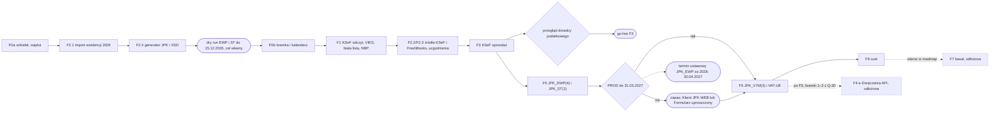

# Kokpit JDG

Indeks dokumentacji, status faz i plan osobistego kokpitu jednej JDG. Kontrakt nazw i słownik: [naming.md](naming.md). Stan na 8 października 2026.

## Status faz

Pracuje jedna osoba po godzinach, ok. 10 h tygodniowo. Plan opiera się na bramkach i datach, nie na szacunkach tygodni. Kolejność realizacji pochodzi z D-30; id faz zostają.

| Kolejność | Faza | Cel | Plik | Status | Dowód |
| --- | --- | --- | --- | --- | --- |
| 1 | F0a szkielet (wąska, D-28) | Compose z projektem prod na VPS, sejf dwupoziomowy, cele per konektor, Messenger, logi, `Redactor`, panel przez Tailscale z TLS i jednym passkeyem, push ntfy, monitoring, backup | [phases/f0a-szkielet.md](phases/f0a-szkielet.md) | kod na `main`, wiersze `ci` zielone; odbiór czeka na VPS i Tailscale (D-18) | — |
| 2, 3, 6 | F2 ewidencja 2026 | F2.1: `revenue_entry` i import 2026 z CSV albo eksportu JPK_EWP(4), K_8 i K_9 policzone w narzędziu. F2.4: generator JPK_EWP(4) i JPK_ST(1) z walidacją XSD, dry run. F2.2/F2.3: źródła KSeF Subject1 i FreshBooks, uzgodnienia, reszta zakresu według pliku fazy | [phases/f2-ewidencja.md](phases/f2-ewidencja.md) | kod F2.1, F2.2, F2.3 i F2.4 (JPK_EWP) na `main`; JPK_ST(1): generator na XSD 1-2 i wiersze `jpk-st-build`, `jpk-st-dry-run` z F5.2 (D-37, D-64), klucze `opening.*` w F5 (D-49); odbiór czeka na F0a (D-36, D-37) | — |
| 4 | F0b bramka i kalendarz | szkielet bramki zatwierdzeń, step-up i drugi passkey, `PolishCalendar`, silnik obowiązków, przypomnienia, ustawienia z datą obowiązywania | [phases/f0b-bramka-kalendarz.md](phases/f0b-bramka-kalendarz.md) | kod na `main`; odbiór czeka na F0a i wiersze `[manual]` (D-38) | — |
| 5 | F1 KSeF odczyt | sync Subject1 i Subject2 od 1.02.2026, przegląd kosztów, koszty spoza KSeF, kursy NBP, VIES, biała lista | [phases/f1-ksef-odczyt.md](phases/f1-ksef-odczyt.md) | kod bez sieci na `main` (D-42); synchronizacja KSeF na api-test działa: eksport Subject1 i Subject2, `ksef-sync-te` i nagranie `te-sync-export` (D-71); poświadczenia, zapas certyfikatem i klucze MF na api-test (D-72); NBP i rejestry czekają | — |
| 7 | F3 KSeF sprzedaż | FreshBooks → FA(3) → bramka → KSeF, QR i PDF, korekty | [phases/f3-ksef-sprzedaz.md](phases/f3-ksef-sprzedaz.md) | kod F3.1–F3.4 na `main` (PR #12–#16, D-50); F3.5 (live) na api-test: `pl_b2b`, `eu_b2b`, `non_eu_b2b` i KOR przyjęte z UPO, duplikat 440, nagrania w CI; `kod-i-qr-test` czeka na Ciebie (D-70); go-live czeka na przegląd doradcy (D-04) | — |
| 8 | F5 JPK | JPK_EWP(4) i JPK_ST(1) w PROD, potem JPK_V7M(3) i VAT-UE | [phases/f5-jpk.md](phases/f5-jpk.md) | kod F5.1 kompletny: PR #18 na `main` (D-57), wiersze `jpk-init-upload` i `jpk-auth-data` na oficjalnych XSD `initupload.xsd` i SIG-2008 (D-63); kod F5.2 (JPK_ST(1) przez bramkę za `jpk_st.enabled`, `jpk-st-request`) na gałęzi `f5-st` (D-64); XSD JPK_V7M(3), VAT-UE(5) i VAT-UEK(5) w `resources/xsd` (D-63), więc F5.4 i F5.5 mogą ruszyć offline; kod F5.4 (JPK_V7M(3), bramki, zamknięcie miesiąca, korekta, `jpk.replace_di`, „Otwarcie”, kwoty WHT) na gałęzi `f5-v7m` (D-65); kod F5.5 (VAT-UE(5) i VAT-UEK(5), bramka K_12, trasa KOR, konektor `edeklaracje` na `FakeEDeklaracjeGateway`) na gałęzi `f5-vatue` (D-66); F5.6 (live) e-Deklaracje: VAT-UE i VAT-UEK przyjęte z UPO na bramce testowej (D-67, D-68); F5.3 i JPK_V7M z F5.6 (live) przechodzą pełną wysyłkę na test-e-dokumenty, TE odrzuca fikcyjne dane autoryzujące kodem 419, przyjęcie z UPO potwierdza pierwsze złożenie PROD (D-69) | — |
| 9 | F6 czat | czat z Claude Haiku 5.5 na narzędziach tylko do odczytu i `draft_document` | [phases/f6-czat.md](phases/f6-czat.md) | F6.1–F6.4 na `main` (PR #20–#23, D-59–D-62); wykres przez `symfony/ux-chartjs` z importmap i CSP z nonce (D-73); F6.5 (live) czeka na klucz Claude API workspace testowego | — |
| – | F4 e-Doręczenia API | lista i odbiór pism przez API | sekcja „Odłożone” | odłożona (D-29) | — |
| – | F7 basal | lokalny klasyfikator w trybie cienia | sekcja „Odłożone” | odłożona (D-29) | — |

- Faza jest ukończona tylko z listą `docs/evidence/<phase>.md`: wszystkie wiersze pass, wiersze `[manual]` odhaczone przez Ciebie (D-28).
- Każdy wiersz kryteriów odbioru ma kolumnę „Dowód”. Artefakt to raport JUnit albo plik z przebiegu CI; przy `[manual]` zrzut albo odhaczony wpis.
- F2 ma jedną listę `docs/evidence/f2.md`. Wiersze F2.1 i F2.4 mają pass przed dry runem; F2 kończy się po F2.2/F2.3.
- Po odbiorze kolumna „Dowód” linkuje listę. „—” oznacza brak listy.
- Definicja ukończenia: [../.claude/rules/zasady-twarde.md](../.claude/rules/zasady-twarde.md); CI i kryteria przekrojowe: [testing.md](testing.md).

## Cel, zakres i założenia

Osobisty kokpit jednej JDG: automatyzuje KSeF i JPK, weryfikuje kontrahentów i pilnuje terminów bez API (ZUS, e-Urząd Skarbowy, e-Doręczenia).

**Założenia**

| Założenie | Skutek |
| --- | --- |
| Jeden użytkownik, jeden NIP, self-hosted | brak multi-tenancy; prostsze bezpieczeństwo i RODO |
| Jedna osoba po godzinach, ok. 10 h tygodniowo | wąska F0a i szybka ścieżka do dry runu (D-28, D-30); odłożone moduły w sekcji „Odłożone” |
| Tylko B2B: klienci z UE, spoza UE i z Polski; bez B2C | VAT-UE w zakresie; OSS poza zakresem. Zatwierdzenie faktury wymaga identyfikatora nabywcy: ważny VIES (UE), zagraniczny identyfikator z dowodem (spoza UE) albo NIP sprawdzony na białej liście (PL); NIP bez statusu w wykazie wymaga `manual_evidence` ([modules/rejestry-kursy.md](modules/rejestry-kursy.md)). Nabywca z UE bez ważnego VIES, ale prowadzący działalność: `eu_b2b_unidentified`, `np I`, bez VAT-UE, do potwierdzenia przez doradcę (Q-29) |
| VAT rozliczany miesięcznie (JPK_V7M) | pierwszy JPK_EWP za 2026, termin 30.04.2027 ([broszura JPK_EWP(4)](https://www.podatki.gov.pl/media/0qmfysqh/broszura_informacyjna_dot_jpk_ewp-4.pdf)) |
| Wszystkie deklaracje i pliki składasz sam, bez biura rachunkowego | jednorazowy przegląd doradcy podatkowego to bramka przed go-live F3 (D-04) |
| Odczyt i synchronizacja działają automatycznie | każdy zapis w urzędzie (faktura, JPK, VAT-UE, wiadomość) tylko przez bramkę zatwierdzeń; zero automatycznych wysyłek i ponowień |
| Każdy konektor startuje na środowisku testowym | produkcję włącza osobna zmienna per konektor, ustawiana ręcznie |
| FreshBooks zostaje do obsługi klientów i płatności (Stripe) | prawnie wiążąca jest faktura z numerem KSeF; klient dostaje dokument dopiero po nadaniu numeru; bez firmy testowej (D-35) |
| Panel webowy tylko przez VPN (Tailscale), push przez ntfy | backend działa 24/7 na VPS; sekrety nie trafiają na telefon; bez PWA i Web Push (D-08, D-28) |
| Źródłem prawdy jest katalog `docs/` w repo | dokument w claude.ai jest zamrożony |

**Poza zakresem**

- ZUS i e-Urząd Skarbowy przez API, bo publicznego API nie ma. Zostają przypomnienia i wyliczenia kwot.
- Scraping portali urzędowych.
- Sprzedaż B2C i OSS.
- WHT, IFT-2R i CIT-10Z: kokpit przypomina i liczy, żadna faza nie planuje wysyłki.
- PIT-28: kokpit daje zestawienie roczne; wysyłka przez e-Deklaracje poza planem faz.
- Wersja dla innych firm: decyzja odłożona, notatki poza repo.

**Kup czy zbuduj.** Przy samej zgodności z KSeF gotowy program fakturowy wystarczy. Własny kokpit zachowuje FreshBooks, daje jedno miejsce na alerty i kontrolę danych (D-09).

### Role i dostęp

| Rola | Kto | Zakres |
| --- | --- | --- |
| Właściciel | Ty | jedyny użytkownik panelu; zatwierdzasz każdy zapis, odbierasz pisma, płacisz ręcznie |
| Doradca podatkowy | zewnętrzny, jednorazowo | przegląd mapowania FA(3) i PKWiU→ryczałt; zakres w Q-29, wynik w [decisions.md](decisions.md) przed go-live F3 |
| Administrator skrzynki ADE | nieustalony (Q-18) | zastępca przy odbiorze pism w skrzynce e-Doręczeń |
| Zastępca poza skrzynką | nieustalony (Q-18) | przejmuje terminy, gdy Cię nie ma; procedura break-glass w [operations.md](operations.md) |

## Teraz – zgodność

Obowiązki już biegną, a kokpit przejmie je dopiero po go-live właściwej fazy. Do tego czasu składasz sam w darmowych narzędziach MF.

**Obowiązki i przejęcie przez kokpit**

| Obowiązek | Obowiązuje | Teraz: kto i czym | Przejmuje kokpit |
| --- | --- | --- | --- |
| Faktury sprzedaży w KSeF | od 1.04.2026; zwolnienie do 10 tys. zł brutto miesięcznie traci się trwale od faktury, która przekracza limit ([MF](https://ksef.podatki.gov.pl/ponizej-10-000-zl/), [Dz.U. 2025 poz. 1203](https://api.sejm.gov.pl/eli/acts/DU/2025/1203/text.pdf)) | Ty, [Aplikacja Podatnika KSeF](https://ksef.podatki.gov.pl/jdg-i-msp/) albo obecne narzędzie (Q-10); we FreshBooks bez Send przed nadaniem numeru KSeF | F3 |
| Faktury kosztowe w KSeF | odbiór od 1.02.2026 ([MF](https://ksef.podatki.gov.pl/ponizej-10-000-zl/)); do 31.12.2026 część kosztów może przyjść poza KSeF (zwolnienie do 10 tys. zł u sprzedawcy) | Ty, Aplikacja Podatnika KSeF: pobranie i przegląd przed JPK_V7M | F1 odczyt, F5 JPK |
| Elektroniczna ewidencja przychodów, wpis do 20. dnia następnego miesiąca | od 1.01.2026 ([rozporządzenie, Dz.U. 2025 poz. 1294](https://api.sejm.gov.pl/eli/acts/DU/2025/1294/text.pdf), [ustawa o ryczałcie](https://api.sejm.gov.pl/eli/acts/DU/2025/843/text.pdf)) | Ty, narzędzie z Q-11; MF nie daje darmowego narzędzia do ewidencji w ciągu roku ([narzędzia MF](https://www.podatki.gov.pl/podatki-firmowe/jednolity-plik-kontrolny/jpk_pd/bezplatne-narzedzia)) | F2: import 2026 w F2.1, wpisy bieżące po go-live |
| JPK_V7M do 25. dnia, z importem usług w K_27–K_30 (Anthropic, FreshBooks, hosting) | JPK_V7M(3) od okresu 02.2026 ([broszura MF](https://www.podatki.gov.pl/media/wgbkrejs/broszura-jpk_vat-z-deklaracj%C4%85-od-1-lutego-2026-r.pdf)) | Ty, [e-mikrofirma w e-Urzędzie Skarbowym](https://ksef.podatki.gov.pl/jdg-i-msp/) albo plik przez Klient JPK WEB (Q-12) | F5 |
| VAT-UE do 25. dnia za miesiąc z usługami art. 28b dla podatników z UE | art. 100 ustawy o VAT ([Dz.U. 2026 poz. 1263](https://api.sejm.gov.pl/eli/acts/DU/2026/1263/text.pdf)) | Ty, e-Deklaracje (Q-12) | F5 |
| WHT od usług zagranicznych: wpłata do 7., IFT-2R do końca marca, CIT-10Z do końca stycznia | art. 26 i 26a ustawy o CIT ([Dz.U. 2026 poz. 554](https://api.sejm.gov.pl/eli/acts/DU/2026/554/text.pdf)) | Ty, e-Deklaracje; klasyfikacja dostawców w Q-21 | przypomnienia od F0b; wysyłka zawsze ręczna |
| Zaliczka na ryczałt i składki ZUS do 20. | zaliczka: art. 21 ustawy o ryczałcie ([Dz.U. 2025 poz. 843](https://api.sejm.gov.pl/eli/acts/DU/2025/843/text.pdf)); ZUS: art. 47 ust. 1 pkt 4 ustawy o systemie ubezpieczeń społecznych ([Dz.U. 2026 poz. 199](https://api.sejm.gov.pl/eli/acts/DU/2026/199/text.pdf)) | Ty, przelew ręczny | przypomnienia od F0b, kwoty od F2 |
| e-Doręczenia: ADE firmy w BAE; fikcja doręczenia biegnie niezależnie od kokpitu | od 1.10.2026 dla firm z CEIDG wpisanych przed 1.01.2025 ([gov.pl](https://www.gov.pl/web/e-doreczenia/e-doreczenia-1-pazdziernika-2026-r-wazny-termin-dla-przedsiebiorcow-z-ceidg)) | Ty i administrator skrzynki, aplikacja e-Doręczeń; powiadomienia mailowe; codzienny podgląd skrzynki (Q-13, Q-18) | przypomnienia `manual_channel_check` od F0b; termin z pisma wpisujesz do kalendarza; API odłożone (D-29); powiadomienia mailowe zostają na stałe |
| Inne kanały doręczeń: prywatny ADE, konto e-US (przy zgodzie na e-Korespondencję), eZUS | według kanału ([Ordynacja podatkowa, Dz.U. 2026 poz. 622](https://api.sejm.gov.pl/eli/acts/DU/2026/622/text.pdf)) | Ty, ręczny przegląd raz w tygodniu; tabela kanałów w [modules/e-doreczenia.md](modules/e-doreczenia.md) | przypomnienia od F0b |
| JPK_EWP(4) i JPK_ST(1) za 2026 | termin 30.04.2027 ([broszura JPK_EWP(4)](https://www.podatki.gov.pl/media/0qmfysqh/broszura_informacyjna_dot_jpk_ewp-4.pdf)) | jeszcze nic do złożenia | dry run po F2.4, wysyłka w F5; zapas: Formularz uproszczony i Klient JPK WEB ([narzędzia MF](https://www.podatki.gov.pl/podatki-firmowe/jednolity-plik-kontrolny/jpk_pd/bezplatne-narzedzia)) |

**Zasady okresu przejściowego**

- Jeden obowiązek ma jedno źródło wysyłki. Kokpit w okresie równoległym tylko liczy i porównuje z Twoim obecnym narzędziem.
- Po go-live fazy wyłączasz stare narzędzie dla tego obowiązku. Checklisty go-live są w [operations.md](operations.md).
- e-Doręczenia: teraz bez wniosku o dostęp INT i bez certyfikatu kwalifikowanego (D-29). Powrót w sekcji „Odłożone”.

## Plan faz

Kolejność z D-30: najpierw wąska F0a i ewidencja, bo JPK_EWP to jedyny nowy plik z twardym terminem. KSeF i FreshBooks wchodzą po dry runie jako źródła uzgodnień. Do go-live faz chroni Cię sekcja „Teraz – zgodność”.

**Kamienie milowe**

Data 15.12.2026 to Twój cel, nie termin ustawowy. Ustawowe są wpis do ewidencji do 20. dnia następnego miesiąca i JPK_EWP(4) za 2026 do 30.04.2027. Termin 30.04.2027 spełnisz też darmowymi narzędziami MF (D-30).

| Data | Kamień | Typ | Jeśli nie |
| --- | --- | --- | --- |
| 09.10.2026 | decyzja hostingu (Q-14): przyjęta, D-18 | bramka [F0] | – |
| 15.11.2026 | najpóźniejszy start F2.1 | bramka harmonogramu | dry run 15.12.2026 zagrożony; termin ustawowy bez zmian |
| 30.11.2026 | termin publikacji UD458: limit ryczałtu na 2027 z 2 mln do 250 tys. EUR, nieuchwalone na 08.10.2026 ([proces druku 3147](https://api.sejm.gov.pl/sejm/term10/processes/3147)) | obserwacja | decyzja o formie opodatkowania 2027 (Q-38) |
| przed 1.12.2026 | ponowne sprawdzenie §13 rozporządzenia o tokenach KSeF ([Dz.U. 2025 poz. 1815](https://api.sejm.gov.pl/eli/acts/DU/2025/1815)) | obserwacja | wpis w [facts.md](facts.md) |
| 15.12.2026 | dry run JPK_EWP(4) i JPK_ST(1) na danych sty–lis 2026 ze źródła `import`, zgodny z XSD | cel własny (D-30) | F5 zaczyna od napraw ewidencji; zapas z 31.03.2027 staje się realny |
| 31.12.2026 | koniec tokenów KSeF według §13; tokeny wydane do tej daty działają najpóźniej do 30.11.2027 ([CIRFMF #834](https://github.com/CIRFMF/ksef-api/issues/834)) | ryzyko | certyfikat KSeF typ 1 jako sprawdzony zapas z F1 |
| 1.01.2027 | kary za błędy w KSeF: odroczenie do 31.12.2027 zapowiedziane, nieuchwalone na 08.10.2026 ([MF](https://www.gov.pl/web/finanse/przedluzenie-odroczenia-kar-za-bledy-w-stosowaniu-ksef-do-konca-2027-r)) | ryzyko | planuj, jakby kary obowiązywały |
| przed go-live F3 | przegląd doradcy zapisany w [decisions.md](decisions.md) | bramka | F3 zostaje na api-test |
| 31.03.2027 | JPK_EWP(4) i JPK_ST(1) za 2026 wysłane z kokpitu w PROD; JPK_ST zależny od projektu zwolnienia, nieuchwalonego na 08.10.2026 ([projekt](https://legislacja.gov.pl/projekt/12413609)) | bramka zapasowa | XML z kokpitu przez Klient JPK WEB albo plik z Formularza uproszczonego |
| 30.04.2027 | termin JPK_EWP za 2026 i PIT-28; piątek, bez przesunięcia ([broszura JPK_EWP(4)](https://www.podatki.gov.pl/media/0qmfysqh/broszura_informacyjna_dot_jpk_ewp-4.pdf)) | termin ustawowy | – |

Przedłużenie terminów JPK na 2026 z [Dz.U. 2026 poz. 779](https://api.sejm.gov.pl/eli/acts/DU/2026/779/text.pdf) dotyczy tylko ksiąg rachunkowych, nie JPK_EWP.

## Odłożone

Tabela obejmuje wszystkie osiem elementów z „Odłożonych z planu faz” w [roadmap.md](roadmap.md); tam są warunki powrotu. Powrót wymaga nowego rekordu D-xx w [decisions.md](decisions.md); szkic kryteriów powstaje wtedy z pliku modułu.

| Element | Do tego czasu | Decyzja |
| --- | --- | --- |
| F4 e-Doręczenia API (INT i PROD) | powiadomienia mailowe, odbiór ręczny w aplikacji e-Doręczeń, `manual_channel_check` od F0b, termin z pisma wpisany do kalendarza; [modules/e-doreczenia.md](modules/e-doreczenia.md) zostaje | D-29 |
| F7 basal | decyzje klasyfikacji podejmujesz w panelu; [modules/basal.md](modules/basal.md) oznaczony „odłożone” | D-29 |
| rejestry KRS, CEIDG, GUS | VIES, biała lista, NBP; kontrahent spoza UE z `manual_evidence` | D-20, D-29 |
| strumieniowanie odpowiedzi czatu | odpowiedź w synchronicznym żądaniu z ramką Turbo | D-29 |
| eskalacja czatu do Sonnet 5.5 | tylko Claude Haiku 5.5 | D-10, D-29 |
| PWA i Web Push | push przez aplikację ntfy | D-28 |
| okna przesuwne limitów | `rate_counter` z `blocked_until` i `Retry-After` | D-29 |
| komenda demo fazy i generator podsumowania dowodów | raport JUnit z CI, artefakty przebiegu i ręcznie pisana lista `docs/evidence/<phase>.md` | D-28 |

## Warunki wstępne

| Pozycja | Właściciel | Czas oczekiwania | Blokuje | Termin | Status |
| --- | --- | --- | --- | --- | --- |
| Hosting: VPS w UE tylko z projektem prod, RAM ≥ 2 GB, Tailscale i nazwa DNS w VPN dla TLS (D-28) | Ty | dni | F0a | przed wdrożeniem F0a | przyjęte 2026-10-09 (Q-14, D-18); VPS do wynajęcia |
| Kanał push: self-hosted ntfy albo ntfy.sh z tokenem | Ty | od ręki | odbiór `push-test` w F0a | krok 0 F0a | otwarte (Q-15) |
| Dostawca SMTP dla maila zapasowego; poświadczenia w Symfony Secrets | Ty | od ręki | odbiór `push-test-mail` w F0a | krok 0 F0a | otwarte (Q-40) |
| Cel backupu poza serwerem w UE; klucze w menedżerze haseł i na papierze | Ty | dni | F0a | przed końcem F0a | otwarte (Q-41) |
| Zewnętrzny serwis dead-man: healthchecks.io albo Uptime Kuma na innym hoście | Ty | od ręki | go-live F0a | przed końcem F0a | otwarte (Q-42) |
| Plan GitHub: wymagane checki przez ruleset albo ochronę gałęzi `main` w repo prywatnym | Ty | od ręki | odbiór F0a (`ci-green`) | przed F0a | do sprawdzenia (Q-43) |
| Umowy powierzenia z hostingiem, celem backupu i dostawcą SMTP (art. 28 [RODO](https://uodo.gov.pl/pl/file/1460)) | Ty | dni | go-live F0a | przed końcem F0a | otwarte ([security.md](security.md)) |
| Eksport ewidencji 2026 z narzędzia z Q-11: CSV z K_1–K_10 albo XML JPK_EWP(4), z policzonymi K_8 i K_9 | Ty | od ręki po wyborze narzędzia | F2.1 | przed F2.1 | otwarte (Q-11, D-30) |
| XSD (FA(3), JPK_V7M(3), JPK_EWP(4), JPK_ST(1), VAT-UE(5), VAT-UEK(5), SIG-2008) i certyfikaty MF per środowisko | sesja fazy | od ręki | F2.4, F3, F5 | start fazy | zasady w [../.claude/rules/integrations.md](../.claude/rules/integrations.md) |
| Mikrorachunek podatkowy ([generator](https://www.podatki.gov.pl/generator-mikrorachunku-podatkowego)) i rachunek składkowy ZUS w konfiguracji | Ty | od ręki | F0b | przed F0b | otwarte |
| Wariant składek ZUS i próg składki zdrowotnej | Ty | od ręki | F0b (kwoty), F2 | przed F0b | otwarte (Q-16) |
| Dane testowe KSeF TE: podmioty przez `/testdata`, drugi sprzedawca testowy, certyfikat typ 1 self-signed, tokeny ([środowiska KSeF](https://raw.githubusercontent.com/CIRFMF/ksef-docs/main/srodowiska.md), [testing.md](testing.md)) | sesja F1 | od ręki | – | sesja 1 F1, bez bramki „stop” | wytwarza sesja F1 (Q-39) |
| Linia biblioteki KSeF PHP | Ty | od ręki | F1 | przed F1 | otwarte (Q-19) |
| Certyfikat KSeF typ 1 na PROD; wniosek wymaga podpisu XAdES (PZ albo QES) ([MF](https://ksef.podatki.gov.pl/informacje-ogolne-ksef-20/certyfikaty-ksef/)) | Ty | dni | zapas po końcu tokenów; nie jest warunkiem go-live F1 | przed 31.12.2026, po przeglądzie §13 przed 1.12.2026 ([facts.md](facts.md)) | otwarte |
| FreshBooks: ręcznie pisane fixtures i prawdziwa firma tylko do odczytu; aplikacja OAuth z przekierowaniem HTTPS ([FreshBooks](https://www.freshbooks.com/api/authentication)); bez firmy testowej | Ty | dni | F2.2/F2.3, F3 | przed F2.2 | otwarte (D-35) |
| Rezerwacja doradcy podatkowego | Ty | tygodnie | go-live F3 | przed F3 | otwarte (Q-29) |
| Certyfikat KSeF typ 2 (offline) – tylko przy trybie offline | Ty | dni | F3 | przed F3 | zależne od Q-28 |
| Bramki 1–2 wykonalności e-Doręczeń PROD: typ dostawcy ADE, zakładka Systemy w Module uprawnień, rola właściciela albo administratora ([modules/e-doreczenia.md](modules/e-doreczenia.md)) | Ty | od ręki | powrót do F4 | przed F4 | do sprawdzenia (Q-30) |
| Dane autoryzujące (`auth_data`): data urodzenia do `Podmiot1` przed dry runem na danych PROD, przychód N−2 przed F5 PROD | Ty | od ręki | dry run na danych PROD, F5 PROD | przed dry runem; potem co roku 2 stycznia | otwarte ([security.md](security.md)) |
| Certyfikaty rezydencji zagranicznych dostawców (WHT) | Ty | tygodnie | przypomnienia od F0b, F5 | przed F5 | otwarte (Q-21) |
| Parametry ZUS na 2027 | ZUS (publikacja) | styczeń 2027 | kwoty kalendarza 2027 | styczeń 2027 | czeka |
| Konto Claude API: osobne workspace testowe i PROD, klucze z niskim limitem wydatków w Symfony Secrets | Ty | od ręki | F6.5 (live, workspace testowe), go-live F6 (PROD); F6.1–F6.4 bez klucza (D-58) | przed F6.5 | otwarte |

Warunki powrotu F4 (INT, certyfikat kwalifikowany, bramki 3–4) i rejestrów KRS, CEIDG i GUS są w [roadmap.md](roadmap.md).

## Jak czytać dokumentację

- Start sesji: ten plik oraz [../.claude/rules/zasady-twarde.md](../.claude/rules/zasady-twarde.md), który ładuje się sam.
- Krok 0 fazy: plik fazy, [naming.md](naming.md), wiersze tej fazy w [decisions.md](decisions.md) i fakty tej fazy w [facts.md](facts.md). Brak wejścia „stop” z pliku fazy oznacza stop i pytanie; reszta idzie na założeniu domyślnym. Pełna reguła: krok 0 w [../.claude/rules/zasady-twarde.md](../.claude/rules/zasady-twarde.md).
- Plik fazy zawiera autorytatywną listę plików do wczytania. Tabela niżej to przegląd.
- Jedna faza albo jej część na sesję. Bez `@import` plików faz w `CLAUDE.md`, bo importy ładują się na starcie ([Claude Code](https://code.claude.com/docs/en/memory)).
- Temat ma jeden plik-dom; pozostałe pliki linkują do niego bez kopiowania. Reguła P_1: [modules/ksef.md](modules/ksef.md). Reguła kursu NBP: [tax-rules.md](tax-rules.md). API NBP: [modules/rejestry-kursy.md](modules/rejestry-kursy.md). Tabele i stany encji: [data-model.md](data-model.md). Stany zatwierdzeń: [approval-gate.md](approval-gate.md). Nazwy: [naming.md](naming.md).

| Plik | Dom tematów | Ładowany w fazach |
| --- | --- | --- |
| [../.claude/rules/zasady-twarde.md](../.claude/rules/zasady-twarde.md) | zasady twarde, komendy, układ katalogów, definicja ukończenia, krok 0 fazy | zawsze, automatycznie |
| [../.claude/rules/integrations.md](../.claude/rules/integrations.md) | kontrakt konektora, XSD, zapis wysłanych bajtów, czyszczenie fixtures | automatycznie przy edycji `src/Connector/**`, `src/Xml/**`, `resources/xsd/**`, `tests/Fixtures/**` |
| `CLAUDE.md` | lokalny wskaźnik na reguły i ten plik, poza repo | zawsze, automatycznie |
| README.md | status, założenia, „Teraz – zgodność”, plan faz, kamienie milowe, odłożone, warunki wstępne, zaślepki F3, F5, F6 | start każdej sesji |
| [naming.md](naming.md) | słownik PL→EN, kontrakt nazw, nazwy wycofane | krok 0 każdej fazy; przed dodaniem nazwy |
| [decisions.md](decisions.md) | pytania Q-xx z założeniami domyślnymi, decyzje D-xx | krok 0 każdej fazy |
| [facts.md](facts.md) | fakty z datą weryfikacji, obserwacja prawa, ryzyka, źródła | krok 0 każdej fazy |
| [architecture.md](architecture.md) | komponenty, konektory, cele per konektor, allowlista hostów, liczniki limitów, biblioteki | F0a; każda faza z nowym konektorem |
| [operations.md](operations.md) | hosting, compose, katalog zadań, Messenger, monitoring, backup, rotacje, go-live, break-glass | F0a; krok go-live każdej fazy |
| [security.md](security.md) | inwentarz sekretów, panel (TLS, passkey, step-up), `Redactor`, `audit_log` i `connector_call`, retencja, RODO | F0a, F0b, F6; każda faza z sekretami lub logami |
| [testing.md](testing.md) | polityka testów, fixtures, `@group live`, CI, kryteria przekrojowe, dowód działania | każda faza (plan i koniec) |
| [approval-gate.md](approval-gate.md) | semantyka i stany zatwierdzeń, rekoncyliacja, „Odbierz” jako akcja logowana | F0b, F2 (złożenie poza kokpitem), F3, F5, F6 |
| [data-model.md](data-model.md) | tabele, pola, stany encji, przejścia faktur i złożeń, typy kwot i dat, układ plików | każda faza (sekcje tej fazy) |
| [compliance-calendar.md](compliance-calendar.md) | silnik terminów, tabela obowiązków, przesunięcia, zamknięcie miesiąca, blokada okresu | F0b, F1 (`vat_ue`, `wht_payment`, `wht_certificate`), F2, F3 (`invoice_issue`), F5 |
| [tax-rules.md](tax-rules.md) | reguła kursu NBP (PIT, VAT, art. 31a ust. 2a), PKWiU→ryczałt, zaliczka, ZUS, import usług, WHT, płatności, B2B | F1 (kursy), F2, F3, F5 |
| [modules/ksef.md](modules/ksef.md) | przejście, uwierzytelnienie, reguła P_1, FA(3), sync, korekty KOR, awarie, QR, limity | F1, F2.2/F2.3 (Subject1), F3 |
| [modules/freshbooks.md](modules/freshbooks.md) | znacznik gotowości, blokady wysyłki, zapis zwrotny, płatności | F2.2/F2.3 (import), F3 |
| [modules/ewidencja.md](modules/ewidencja.md) | `revenue_entry`, mapowanie JPK_EWP(4), import 2026, uzgodnienia | F2, F5 |
| [modules/jpk.md](modules/jpk.md) | API JPK 5.6.0, JPK_V7M(3), JPK_EWP(4), JPK_ST(1), VAT-UE, korekty | F2.4 (dry run), F5 |
| [modules/rejestry-kursy.md](modules/rejestry-kursy.md) | VIES, biała lista (dwa liczniki), API NBP | F1 |
| [modules/e-doreczenia.md](modules/e-doreczenia.md) | kanały doręczeń, procedura ręczna; API odłożone | F0b (kanały) |
| [modules/czat.md](modules/czat.md) | narzędzia, dane do modelu, profil Haiku 5.5, budżety | F6 |
| [modules/basal.md](modules/basal.md) | uruchomienie i kalibracja basal; odłożone (D-29) | nigdy do powrotu modułu |
| [phases/f0a-szkielet.md](phases/f0a-szkielet.md) i pozostałe pliki faz | zakres, wejścia, pliki do wczytania, kryteria, go-live | tylko swoja faza |
| `docs/evidence/<phase>.md` | ręcznie pisana lista dowodów: data, commit, przebieg CI, kryterium → pass albo fail → artefakt, odhaczone `[manual]` | koniec swojej fazy (zapis), jako warunek odbioru |
| [roadmap.md](roadmap.md) | propozycje rozwoju, odłożone elementy z warunkiem powrotu | nigdy w sesjach faz |
| [archive/SPEC-2026-10-05.md](archive/SPEC-2026-10-05.md) | oryginalna specyfikacja z 5.10.2026 | nigdy w sesjach faz; tylko weryfikacja pokrycia |

## Zaślepki F3, F5, F6

Te fazy dostaną plik fazy przed startem. Kryteria to szkic „akcja → oczekiwany wynik”.

- Plik fazy przenosi szkic do tabeli z kolumnami `Kryterium`, `Komenda / kroki`, `Oczekiwany wynik`, `Dowód` i nadaje klucze slug ([naming.md](naming.md)).
- Lista „Dowody” to minimum artefaktów fazy w CI i w `docs/evidence/<phase>.md`. Dane w artefaktach są fikcyjne albo zamaskowane.

### F3 KSeF sprzedaż

Zaślepka przeniesiona do pliku fazy: [phases/f3-ksef-sprzedaz.md](phases/f3-ksef-sprzedaz.md).

### F5 JPK

Zaślepka przeniesiona do pliku fazy: [phases/f5-jpk.md](phases/f5-jpk.md).

### F6 czat

Zaślepka przeniesiona do pliku fazy: [phases/f6-czat.md](phases/f6-czat.md).

## Archiwum i materiały poza fazami

- [archive/SPEC-2026-10-05.md](archive/SPEC-2026-10-05.md): oryginalna specyfikacja z 5 października 2026, tylko do weryfikacji pokrycia.
- Snapshot badań i przegląd z 8.10.2026 leżą w archiwum poza repo.
- [roadmap.md](roadmap.md): propozycje rozwoju i warunki powrotu odłożonych elementów; nie jest ładowany w sesjach faz.
- Plany płatne: notatki poza repo, decyzja odłożona (D-25).
