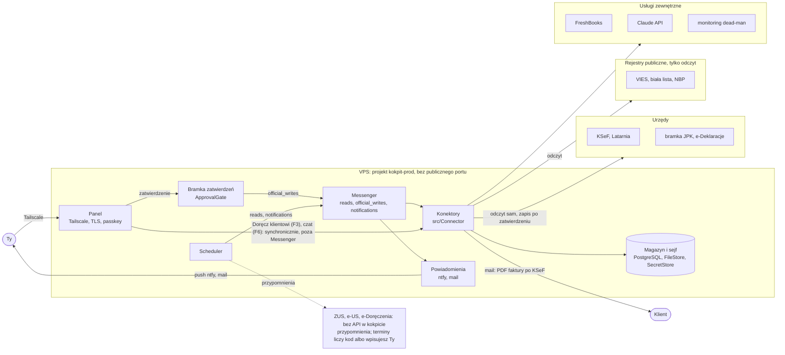

# Architektura

Komponenty, konektory, cele per konektor z allowlistą hostów, liczniki limitów i biblioteki kokpitu. Stan na 8 października 2026.

## Zasada

Jedna aplikacja Symfony z kolejką zadań: osobny konektor na każdy system, wspólny magazyn, jeden kanał powiadomień. Z Tobą kokpit styka się tylko przez panel i push ntfy. Do urzędów wychodzi wyłącznie to, co przeszło przez bramkę zatwierdzeń ([approval-gate.md](approval-gate.md)).

PHP, bo to Twój codzienny stack, a dla KSeF API 2.0 jest dojrzały klient PHP (D-14).

- Odczyt i synchronizacja działają same, z ponowieniami.
- Zapis w urzędzie idzie tylko z bramki, przez transport `official_writes` bez automatycznych ponowień ([operations.md](operations.md)).
- Kwoty, terminy i XML liczy deterministyczny kod. Model językowy niczego nie wysyła.
- Nazwy konektorów, liczników, zmiennych i usług pochodzą z [naming.md](naming.md).

## Diagram

Diagram zastępuje schemat z dokumentu claude.ai (D-01).

## Komponenty

| Komponent | Rola | Implementacja | Faza | Dom szczegółów |
| --- | --- | --- | --- | --- |
| Panel | faktury, ewidencja, kolejka zatwierdzeń, kalendarz, czat | Twig, Symfony UX (Turbo, Stimulus, Chart.js); bez PWA (D-08, D-28) | F0a (logowanie jednym passkeyem), F0b (step-up) | [security.md](security.md) |
| Bramka zatwierdzeń | prośba, zatwierdzenie z hashem payloadu, wysyłka, rekoncyliacja | `src/Approval`: `ApprovalGate`, `SubmissionReconciler` | F0b | [approval-gate.md](approval-gate.md) |
| Scheduler i workery | zadania cykliczne, kolejka | Symfony Scheduler, Messenger (Doctrine) | F0a | [operations.md](operations.md) |
| Konektory | adapter na system zewnętrzny | `src/Connector/<System>` | według faz | ta sekcja, [../.claude/rules/integrations.md](../.claude/rules/integrations.md) |
| Magazyn | dane, stan, pliki adresowane sha256 | PostgreSQL, `FileStore` | F0a | [data-model.md](data-model.md) |
| Sejf | sekrety statyczne i tokeny rotujące | `SecretStore`: Symfony Secrets i `credential_state` | F0a | [security.md](security.md) |
| Powiadomienia | push ntfy i mail bez danych w treści; zasada treści D-19 dotyczy tylko powiadomień | konektory `push`, `mail`, tabela `notification` | F0a, F0b | [security.md](security.md) |
| Kalendarz | terminy z przesunięciami | `PolishCalendar`, `ObligationEngine` | F0b | [compliance-calendar.md](compliance-calendar.md) |
| Ewidencja i podatki | przychody, stawki, zaliczka, kursy | `src/Ledger`, `src/Tax` | F2.1 (`revenue_entry`, import 2026), F1 (kursy, koszty spoza KSeF), dalsze części F2 według [phases/f2-ewidencja.md](phases/f2-ewidencja.md) | [modules/ewidencja.md](modules/ewidencja.md), [tax-rules.md](tax-rules.md) |
| XML | FA(3), JPK, VAT-UE z walidacją XSD | `src/Xml`, `resources/xsd` | F2.4 (JPK_EWP, JPK_ST), F3, F5 | [../.claude/rules/integrations.md](../.claude/rules/integrations.md) |
| Monitoring | `/health`, zewnętrzny dead-man | endpoint, zadanie heartbeat, konektor `deadman` | F0a | [operations.md](operations.md) |
| Czat | pytania o dane, wykresy, szkice; synchroniczne żądanie z ramką Turbo (D-29) | konektor `claude`, rola `chat_ro` | F6 | [modules/czat.md](modules/czat.md) |

- basal (F7) jest odłożony (D-29): bez kontenera i bez konektora. Opis zostaje w [modules/basal.md](modules/basal.md), warunek powrotu w [roadmap.md](roadmap.md).
- Układ katalogów i komendy są w [../.claude/rules/zasady-twarde.md](../.claude/rules/zasady-twarde.md).

## Konektory

Wspólny kontrakt konektora jest w [../.claude/rules/integrations.md](../.claude/rules/integrations.md). W skrócie:

- adres bazowy i wersja API z konfiguracji celu, nigdy literał w kodzie;
- sekrety tylko przez `SecretStore`; konektor nie czyta zmiennych środowiskowych;
- każde wywołanie przez `HostAllowlist`, licznik limitu i wiersz `connector_call`;
- kody błędów systemu jako wyliczenie konektora; obsługa `Retry-After`;
- metody zapisujące w urzędzie wywołuje tylko worker bramki; test architektury pilnuje tej reguły.

| `connector` | Katalog | System | Cel | Dostęp | Odczyt i zapis | Faza |
| --- | --- | --- | --- | --- | --- | --- |
| `ksef` | `Ksef` | KSeF API 2.0 | `KSEF_TARGET` | token KSeF; certyfikat typ 1 jako zapas | sync Subject1 i Subject2; faktury tylko przez bramkę | F1, F3 |
| `latarnia` | `Latarnia` | status dostępności KSeF | `KSEF_TARGET` | bez klucza | odczyt; wstrzymuje `official_writes` dla KSeF | F3 |
| `jpk` | `Jpk` | bramka JPK, specyfikacja 5.6.0 | `JPK_TARGET` | dane autoryzujące | wysyłka przez bramkę; status odczytem | F5 |
| `edeklaracje` | `EDeklaracje` | bramka e-Deklaracji (SOAP) | `EDEKLARACJE_TARGET` | dane autoryzujące (D-27) | VAT-UE i VAT-UEK przez bramkę | F5 |
| `vies` | `Vies` | VIES REST | brak, tylko odczyt | bez klucza | weryfikacja numerów VAT UE | F1 |
| `white_list` | `WhiteList` | API wykazu podatników VAT | brak, tylko odczyt | bez klucza | weryfikacja NIP i rachunków | F1 |
| `nbp` | `Nbp` | API NBP, tabela A | brak, tylko odczyt | bez klucza | kursy średnie | F1 |
| `freshbooks` | `FreshBooks` | FreshBooks API | brak; bez firmy testowej (D-35) | OAuth, aplikacja per wdrożenie | polling faktur i płatności tylko do odczytu; od F3 zapis zwrotny numeru KSeF, pierwszy raz na PROD (D-35) | F2.2/F2.3, F3 |
| `claude` | `Claude` | Claude API (Messages) | brak | klucz osobnego workspace z limitem wydatków | tylko odczyt danych przez narzędzia; synchronicznie w żądaniu panelu | F6 |
| `push` | `Push` | ntfy (D-19, Q-15) | brak | token tematu | powiadomienia | F0a |
| `mail` | `Mail` | dostawca SMTP | brak | poświadczenia SMTP | zapas powiadomień; od F3 doręczenie faktury klientowi (PDF z KOD I, akcja „Doręcz klientowi”) synchronicznie w żądaniu panelu, poza Messenger (D-31, [modules/freshbooks.md](modules/freshbooks.md)) | F0a, F3 |
| `deadman` | `DeadMan` | zewnętrzny serwis dead-man ([operations.md](operations.md)) | brak | adres pingu przez `SecretStore`, tylko w sejfie `prod` | ping po udanym przebiegu zadania z katalogu | F0a |
| `dummy` | `Dummy` | atrapa konektora do testów i bramki przed F3 (D-32) | brak | poświadczenie testowe `dummy_token` | host `dummy.invalid` przez `MockHttpClient`, bez sieci; nigdy przy `APP_ENV=prod` | F0a |

- Claude API jest konektorem: ma nagrane odpowiedzi, licznik i log wywołań ([testing.md](testing.md)).
- Odłożone (D-29): `edoreczenia` (F4, [modules/e-doreczenia.md](modules/e-doreczenia.md)), `basal` (F7) oraz `krs`, `ceidg`, `gus` (D-20). Nazwy są zarezerwowane w [naming.md](naming.md), warunki powrotu w [roadmap.md](roadmap.md).
- Adres pingu `deadman` jest tylko w sejfie `prod`. `kokpit-dev` i `kokpit-restore` nie pingują, więc nie maskują martwego PROD.
- Rejestry, NBP i FreshBooks nie mają zmiennej `*_TARGET` (D-13). Biała lista i VIES mają usługi testowe; NBP nie, a FreshBooks nie ma firmy testowej (D-35). Testy automatyczne używają nagranych odpowiedzi.
- Zapis zwrotny do FreshBooks nie jest zapisem w urzędzie. Działa automatycznie po przyjęciu faktury przez KSeF i jest idempotentny ([modules/freshbooks.md](modules/freshbooks.md)).
- Latarnia nie ma środowiska DEMO ([scenariusze Latarni](https://raw.githubusercontent.com/CIRFMF/ksef-latarnia/main/scenariusze.md)). Latarnia TE zwraca stałe dane przykładowe, więc kolejkę KSeF wstrzymuje tylko Latarnia PROD (D-70). Polityka awarii: [modules/ksef.md](modules/ksef.md) (D-15).

## Środowiska i cele per konektor

Nazwy zmiennych i wartości domyślne są w [naming.md](naming.md). Decyzje: D-13, D-28.

| Zasada | Skutek |
| --- | --- |
| Cel konektora jest niezależny od `APP_ENV` | KSeF może być na PROD miesiące przed JPK |
| Każdy cel ma osobny zestaw poświadczeń | nazwa sekretu zawiera cel ([security.md](security.md)) |
| `CONNECTORS_ENABLED=0`, gdy zmiennej brak | świeży klon, dump deweloperski i odtworzony backup nie wołają nikogo |
| Osobny projekt compose i osobna baza per wdrożenie: `kokpit-prod` na VPS, `kokpit-dev` na laptopie, jednorazowy `kokpit-restore` lokalnie (D-28) | dane deweloperskie nigdy nie trafiają do bazy PROD ([operations.md](operations.md)) |
| Kolumna `environment` w tabelach biznesowych | druga bariera w jednej bazie; plik do urzędu agreguje tylko wiersze swojego celu ([data-model.md](data-model.md)) |
| Baner w panelu | pokazuje każdy konektor, którego cel nie jest `prod`, oraz stan `CONNECTORS_ENABLED=0` |
| Zmiana celu | osobne wdrożenie z restartem; wpis `connector.target_changed` w `audit_log` powstaje w kroku 7 „Wdrożenia” ([operations.md](operations.md)) |
| Zmiana `CONNECTORS_ENABLED` | osobne wdrożenie; wpis `connector.enabled_changed` w kroku 7 „Wdrożenia” ([operations.md](operations.md), [security.md](security.md)) |

**Hosty per cel**

| Konektor | Test | DEMO | PROD | Źródło |
| --- | --- | --- | --- | --- |
| `ksef` | `api-test.ksef.mf.gov.pl` | `api-demo.ksef.mf.gov.pl` | `api.ksef.mf.gov.pl` | [środowiska KSeF](https://raw.githubusercontent.com/CIRFMF/ksef-docs/main/srodowiska.md) |
| KOD I w `ksef` | `qr-test.ksef.mf.gov.pl` | `qr-demo.ksef.mf.gov.pl` | `qr.ksef.mf.gov.pl` | [kody QR](https://raw.githubusercontent.com/CIRFMF/ksef-docs/main/kody-qr.md) |
| `latarnia` | `api-latarnia-test.ksef.mf.gov.pl` | brak | `api-latarnia.ksef.mf.gov.pl` | [scenariusze Latarni](https://raw.githubusercontent.com/CIRFMF/ksef-latarnia/main/scenariusze.md) |
| `jpk` | `test-e-dokumenty.mf.gov.pl`; magazyn `taxdocumentstorageNNtst.blob.core.windows.net` | – | `e-dokumenty.mf.gov.pl`; magazyn `taxdocumentstorageNN.blob.core.windows.net` | [specyfikacja JPK 5.6.0](https://www.podatki.gov.pl/media/bngboylg/specyfikacja-interfejs%C3%B3w-us%C5%82ug-jpk-wersja-560.pdf) |
| klucz publiczny MF w `jpk` (`mf_keys.refresh`, tylko `GET`) | `www.podatki.gov.pl` | – | `www.podatki.gov.pl` | [pliki do pobrania MF](https://www.podatki.gov.pl/podatki-firmowe/jednolity-plik-kontrolny/jpk_vat-z-deklaracja/pliki-do-pobrania) |
| `edeklaracje` | `test-bramka.edeklaracje.gov.pl`, działanie do sprawdzenia | – | `bramka.e-deklaracje.mf.gov.pl` | [specyfikacja e-Deklaracji](https://podatki-arch.mf.gov.pl/media/3616/edek_specyfikacja_we-wy_2-4_test_www.pdf) |
| `white_list` | `wykazpodatnikowvat-test.mf.gov.pl` (dawny `wl-test.mf.gov.pl`) | – | `wykazpodatnikowvat.mf.gov.pl` (dawny `wl-api.mf.gov.pl`) | [API wykazu](https://www.gov.pl/web/kas/api-wykazu-podatnikow-vat) |
| `vies` | `ec.europa.eu`, ścieżka `…/rest-api/check-vat-test-service` | – | `ec.europa.eu`, ścieżka `…/rest-api/check-vat-number` | [VIES test](https://ec.europa.eu/taxation_customs/vies/rest-api/check-vat-test-service) |
| `nbp` | – | – | `api.nbp.pl` | [API NBP](https://api.nbp.pl/en.html) |

- Hosty e-Doręczeń (UA API, SE API, INT i PROD) wracają z F4 (D-29), według [modules/e-doreczenia.md](modules/e-doreczenia.md).
- `freshbooks`, `claude`, `push`, `mail` i `deadman` mają po jednym hoście z konfiguracji. `dummy` ma tylko `dummy.invalid` w `MockHttpClient`.

**Wyjścia poza PHP**

Te wyjścia omijają `HostAllowlist`, `CONNECTORS_ENABLED` i `connector_call`. Pilnuje ich konfiguracja kontenera.

| Wyjście | Host | Uwagi |
| --- | --- | --- |
| kontener `backup`: restic i ping dead-man po `restic backup` ([operations.md](operations.md)) | cel restic w UE, serwis dead-man; oba z konfiguracji kontenera | tylko `kokpit-prod`, jedyne wdrożenie z usługą `backup` |
| `ntfy`: przekazanie przez serwer upstream na iOS (D-19) | `ntfy.sh` | tylko przy self-hosted ntfy (Q-15); tylko identyfikator wiadomości i hash tematu ([security.md](security.md)) |

### `HostAllowlist`

Allowlista w kodzie jest prawdziwą ochroną przed przypadkowym wywołaniem PROD. Reguły deny w `.claude/settings.json` to tylko dodatkowa warstwa ([security.md](security.md)).

- Mapa z konfiguracji: konektor → cel → dozwolone hosty. Host spoza mapy bieżącego celu oznacza wyjątek przed wysłaniem żądania.
- Jedna ścieżka wyjścia HTTP: dekorator Symfony HttpClient. Biblioteka KSeF dostaje go przez `Psr18Client`, a klienty SOAP przez podklasę `SoapClient` sprawdzającą adres.
- `anthropic-ai/sdk` dostaje dekorowany `Psr18Client` jawnie jako `transporter` w `requestOptions` klienta. Bez tego SDK wybiera klienta przez `Psr18ClientDiscovery::find()` i omija allowlistę ([SDK PHP](https://github.com/anthropics/anthropic-sdk-php/blob/main/src/Client.php)).
- Czat działa bez strumieniowania (D-29), więc drugi transporter SDK nie powstaje.
- `mail` wysyła przez Symfony Mailer po SMTP, nie przez HttpClient. Dekorator transportu Mailer sprawdza `CONNECTORS_ENABLED` i host SMTP z allowlisty.
- Ten dekorator zapisuje wiersz `connector_call` z `operation` = `smtp.send` i hostem SMTP; `http_method`, `path` i `http_status` zostają puste.
- Host PROD jest dozwolony tylko przy celu `prod`.
- Wpis może być wzorcem zakotwiczonym. Jedyny taki wpis to magazyn JPK: `^taxdocumentstorage[0-9]{2}tst\.blob\.core\.windows\.net$` przy `JPK_TARGET=test`, bez `tst` przy `prod` ([modules/jpk.md](modules/jpk.md)).
- Konektory bez celu mają listę hostów z konfiguracji wdrożenia. Konfiguracja wdrożenia to `APP_ENV`; projekty compose są w [operations.md](operations.md).
- Hosty PROD rejestrów są tylko przy `APP_ENV=prod`. `kokpit-restore` ma `APP_ENV=prod`, ale `CONNECTORS_ENABLED=0`, więc nie woła nikogo.
- `kokpit-dev` i testy dopuszczają z rejestrów tylko hosty testowe białej listy (`wykazpodatnikowvat-test.mf.gov.pl`, dawny `wl-test.mf.gov.pl`) i ścieżkę `check-vat-test-service` VIES. PROD dopuszcza z VIES tylko ścieżkę `check-vat-number`.
- Usługa testowa VIES leży na hoście PROD, więc dla `vies` sprawdzana jest też ścieżka.
- NBP ma tylko host PROD `api.nbp.pl`. `kokpit-dev` dopuszcza go tylko dla konektora `nbp`, tylko `GET` i przez licznik `nbp.rates`.
- Testy automatyczne NBP zostają na nagraniach przy `CONNECTORS_ENABLED=0` ([testing.md](testing.md)).
- `CONNECTORS_ENABLED=0` blokuje wszystkie konektory, także `push`, `mail`, `claude` i `deadman`.
- Test jednostkowy przechodzi przez każdy konektor z celem innym niż `prod` i pada, jeśli host PROD jest osiągalny. Przy `JPK_TARGET=test` sprawdza też, że host magazynu PROD jest odrzucany.
- Ten sam test sprawdza rejestry przy `APP_ENV` `dev` i `test`. Pada, jeśli adres PROD białej listy albo VIES jest osiągalny.
- Sprawdza też, że żaden konektor poza `nbp` nie dosięga `api.nbp.pl`, a `dummy` nie ma hostów przy `APP_ENV=prod`.
- `www.podatki.gov.pl` jest wspólny dla obu celów `jpk`, jak `ec.europa.eu` dla VIES. Test dopuszcza go tylko dla pobrania klucza MF metodą `GET`.
- Odrzucone żądanie zostaje w `connector_call` z kodem błędu i wywołuje alert.

## Liczniki limitów

Ta sekcja to dom semantyki `rate_counter`. Kolumny są w [data-model.md](data-model.md), wartości limitów w modułach, nazwy grup w [naming.md](naming.md). Decyzja: D-29.

| Zasada | Szczegół |
| --- | --- |
| Klucz | `(environment, connector, bucket, window_start)`; `bucket` według wzorca `<connector>.<grupa>` |
| Okna | dobowe od północy Europe/Warsaw i inne limity kalendarzowe (np. biała lista) |
| Zwiększanie | atomowy `INSERT … ON CONFLICT … DO UPDATE … RETURNING count` przed wywołaniem |
| Przy limicie | zadanie odłożone do następnego okna, bez błędu |
| `Retry-After` i 429 | `blocked_until` w wierszu; konektor nie wywołuje systemu przed tą chwilą |
| Push | przy każdym 429 i przy odłożeniu zadania na kolejne okno dobowe; moduły linkują do tej reguły |
| KSeF | grupy `ksef.*` mają licznik dobowy bez progu i `blocked_until`. Limitów sekundowych, minutowych i godzinowych ([limity API](https://raw.githubusercontent.com/CIRFMF/ksef-docs/main/limity/limity-api.md)) kokpit nie modeluje, bo wolumen to ok. 2 eksporty na godzinę |
| Okna przesuwne | Symfony RateLimiter dopiero po pierwszych odpowiedziach 429 na PROD (wiersz w [roadmap.md](roadmap.md)) |
| Źródło wartości | konfiguracja, nie literały |
| Kontekst | jedna JDG i jedno IP wyjściowe; klucz da się rozszerzyć o NIP kontekstu bez zmiany zapytań |

| Konektor | Grupy | Wartości |
| --- | --- | --- |
| `ksef` | grupy `ksef.*` endpointów API KSeF, np. wysyłka, status, metadane, pobieranie | [modules/ksef.md](modules/ksef.md) |
| `latarnia` | `latarnia.status` | [modules/ksef.md](modules/ksef.md) |
| `white_list` | dwa liczniki: `white_list.search` i `white_list.check` | [modules/rejestry-kursy.md](modules/rejestry-kursy.md) |
| `vies`, `nbp` | `vies.check`, `nbp.rates` | [modules/rejestry-kursy.md](modules/rejestry-kursy.md) |
| `freshbooks` | `freshbooks.api`; 429 z backoffem i `Retry-After`; bez obsługi 409, bo kokpit nie tworzy faktur | [modules/freshbooks.md](modules/freshbooks.md) |
| `claude` | `claude.messages` (D-34): 429 i `blocked_until`; budżety USD liczy kod z sum `chat_message.cost_usd` | [modules/czat.md](modules/czat.md) |
| `jpk` | `jpk.init_upload` | [modules/jpk.md](modules/jpk.md) |
| `edeklaracje` | `edeklaracje.send` (limit dobowy); odczyt `edeklaracje.request_upo` bez limitu dobowego, tylko 429 i `blocked_until` (D-66) | [modules/jpk.md](modules/jpk.md) |
| `push`, `mail` | `push.send`, `mail.send` | konfiguracja: limit odwiedzającego ntfy, dobowy limit dostawcy SMTP |
| `deadman`, `dummy` | `deadman.ping`, `dummy.call` | konfiguracja |

Grupy `edoreczenia.api` i `basal.classify` są odłożone (D-29).

## Biblioteki

Wersje przypina `composer.lock`. Zmiana linii biblioteki to decyzja w [decisions.md](decisions.md).

| Biblioteka | Użycie | Zasada wersji | Licencja i uwagi |
| --- | --- | --- | --- |
| Symfony | framework, Messenger, Scheduler, Workflow, Lock, Clock, Security, HttpClient, Mailer, Uid, UX | linia LTS przypięta w F0a | MIT |
| Doctrine ORM i Migrations | encje, migracje | przypięte | MIT |
| `web-auth/webauthn-symfony-bundle` | passkey | przypięta | [security.md](security.md) |
| `brick/math` | kwoty i kursy, nigdy `float` | przypięta | [data-model.md](data-model.md) |
| `endroid/qr-code` | KOD I | ^5.1, bo tej linii wymaga `ksef-php-client` 1.10.x ([Packagist](https://repo.packagist.org/p2/n1ebieski/ksef-php-client.json)); ≥6.1 dopiero po migracji na 2.x (D-14, D-17) | MIT |
| `dompdf/dompdf` | wizualizacja faktury (silnik HTML→PDF) | ^3.1, wybór sesji F3.4 (D-17, D-55); z `dompdf/php-font-lib` i `dompdf/php-svg-lib` | LGPL-2.1 (zależności LGPL-2.1-or-later i LGPL-3.0-or-later), bez modyfikacji; wyjątek tylko dla tych pakietów w `tools/check-licenses.php` |
| `anthropic-ai/sdk` | Messages API, PHP tool runner (D-11) | dokładna wersja; profil w [modules/czat.md](modules/czat.md) | – |
| `ext-soap` | e-Deklaracje | rozszerzenie PHP | – |
| własne cienkie klienty | bramka JPK, e-Deklaracje; e-Doręczenia (OIDC i REST) dopiero po powrocie F4 | brak utrzymywanej biblioteki PHP | kod kokpitu |
| XSD urzędowe | walidacja FA(3), JPK, VAT-UE, SIG-2008 | w `resources/xsd`, z sumami kontrolnymi, `LIBXML_NONET` | [../.claude/rules/integrations.md](../.claude/rules/integrations.md) |

**Licencje.** Lista dozwolonych licencji działa w CI. Zależności tylko na GPL są wykluczone, np. `mpdf/mpdf` na GPL-2.0-only ([Packagist](https://repo.packagist.org/p2/mpdf/mpdf.json)). Jesteś jedynym właścicielem praw do kodu (D-24).

**Punkt odniesienia dla KSeF.** Oficjalne klienty MF w C# i Javie oraz przewodnik integratora ([CIRFMF](https://github.com/CIRFMF/ksef-api)). Pomagają, gdy biblioteka PHP nie nadąża za zmianą API.

## Decyzje, które nie blokują rozwoju

Tanie wybory na później (D-25 oraz notatki planów płatnych), które dotyczą architektury:

| Wybór | Dlaczego |
| --- | --- |
| DTO faktury niezależne od źródła | FreshBooks to jeden adapter; kolejny nie zmienia mapowania FA(3) |
| jeden klient KSeF na kontekst NIP; poświadczenia przez `SecretStore` per `(environment, kind)`, rozszerzalne o NIP bez zmiany interfejsu | wspólny cache PSR-16 trzyma tylko klucze publiczne MF |
| dane firmy w `setting` `company.identity` | NIP i dane Podmiot1 nie są stałymi w kodzie |
| adresy i wersje API urzędów w konfiguracji | zmiana wersji API nie wymaga zmian w kodzie konektora |
| brak `tenant_id` | jedna baza i jeden katalog plików na wdrożenie |
| kody błędów konektorów jako wyliczenia | stabilne alerty i testy |

## Web czy aplikacja

Panel to aplikacja webowa z backendem na serwerze, bez PWA (D-08, D-28). Backend i tak działa 24/7, a tokeny i klucze nie trafiają na telefon. Passkey wymaga TLS na stałej nazwie DNS w VPN ([security.md](security.md)).

- Jeden stack: Symfony, Twig i Symfony UX, bez osobnego SPA i drugiego repo.
- Czat to kolejny widok panelu; odpowiedź przychodzi w ramce Turbo (D-29).
- Push idzie przez aplikację ntfy (D-19). PWA i Web Push są wierszami w [roadmap.md](roadmap.md).
- Aplikacja natywna ma sens później, np. do skanowania faktur. Łączy się wtedy z tym samym backendem.
